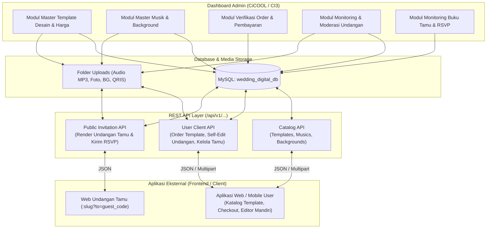
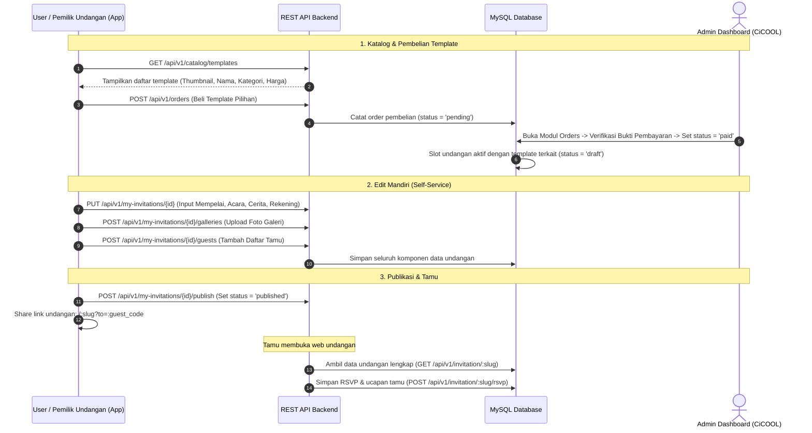

# Rencana Pengembangan Sistem Dashboard Admin & REST API Wedding Digital

Dokumen ini memfokuskan arsitektur pada **Sisi Backend & Dashboard Admin (CiCOOL / CodeIgniter 3)** sebagai pusat kendali master katalog template, musik, background, verifikasi transaksi pembelian template, moderasi undangan, serta penyedia **REST API** dalam model bisnis **Direct Template Marketplace & Self-Service Builder**.

---

## 1. Model Bisnis & Ruang Lingkup Sistem (Template Marketplace)

Model bisnis platform ini berbasis **Beli Template Langsung & Edit Mandiri**:
1. **User Pilih & Beli Template**: User melihat katalog desain template pernikahan. Setiap template memiliki harga jual (`price`) langsung atau gratis (`tier = free`). User membeli template yang disukai tanpa perlu pusing memilih paket langganan kuota (*Bronze/Silver/Gold*).
2. **User Edit Mandiri (Self-Service)**: Setelah memiliki template, User memiliki akses penuh untuk mengisi seluruh data undangan pernikahannya (mempelai pria & wanita, rangkaian acara akad/resepsi, galeri foto & video, kisah perjalanan cinta, amplop digital/QRIS, musik, background, hingga manajemen buku tamu) via REST API atau aplikasi client.
3. **Publikasi & Tamu Undangan**: User membagikan tautan undangan personal kepada tamu (`/:slug?to=:guest_code`). Tamu membuka web undangan, membaca informasi acara, dan mengirimkan RSVP serta ucapan doa.
4. **Fungsi Dashboard Admin (CiCOOL)**:
   - Mengelola katalog **Master Template Desain** (thumbnail preview, nama, slug, kategori, tier, dan harga `price`).
   - Mengelola koleksi **Master Musik** (MP3) & **Master Background**.
   - Memantau & memverifikasi transaksi/order masuk (`orders`).
   - Monitoring & moderasi seluruh undangan yang dibuat (`invitations`) beserta buku tamu & RSVP.
   - Tidak lagi memerlukan operasional manual "Joki Admin" maupun konsep rumit "Paket Layanan".

### Diagram Arsitektur & Alur Data (Template Marketplace)

---

## 2. Alur Pengguna (Template Marketplace Flow)

---

## 3. Ringkasan Database & Tabel Utama

1. **`templates`**: Produk utama platform (nama, slug, thumbnail preview, file layout/demo, kategori, tier, dan **`price`**).
2. **`musics`**: Master koleksi musik latar (judul, artis, file MP3, kategori).
3. **`backgrounds`**: Master tema visual background (nama, file gambar, kategori).
4. **`orders`**: Transaksi pembelian template (invoice, user, total bayar, bukti bayar, status bayar).
5. **`invitations`**: Inti data undangan user (user, template, title, slug, status: draft/published/expired, counter views).
6. **`invitation_couples`**: Data mempelai pria & wanita (nama lengkap, panggilan, orang tua, foto, sosmed).
7. **`invitation_events`**: Rangkaian acara (Akad, Resepsi, Ngunduh Mantu, alamat, koordinat maps).
8. **`invitation_galleries`**: Galeri foto dan video prewedding/wedding.
9. **`invitation_stories`**: Kisah perjalanan cinta (timeline cerita).
10. **`invitation_wallets`**: Amplop digital (Bank, E-Wallet, QRIS).
11. **`invitation_guests`**: Daftar nama tamu undangan & kode personalisasi URL.
12. **`invitation_rsvps`**: Konfirmasi kehadiran dan ucapan doa dari tamu.

---

## 4. Tampilan Modul di Dashboard Admin (CiCOOL / AdminLTE)

Tampilan tabel list data di seluruh modul rapi dan konsisten memakai **styling bawaan CiCOOL** (`table table-bordered table-striped dataTable`), tanpa kolom berlebih:

1. **Template Desain (`templates`):** Thumbnail Preview, Nama & Slug, Kategori, Tier Badge, **Harga (Rp / Gratis)**, Demo Link, Status, Action.
2. **Undangan (`invitations`):** Judul Undangan & Link Slug, **Template Desain**, Status Badge, Total Dilihat, Action.
3. **Pesanan & Tagihan (`orders`):** No. Invoice, Pelanggan, **Item Pesanan (Beli Template)**, Total Bayar, Metode Bayar, Bukti Bayar, Status Bayar Badge, Tanggal Order, Action.
4. **Musik (`musics`):** Judul Lagu, Artis, Pemutar Audio Compact, Kategori, Status, Action.
5. **Background (`backgrounds`):** Thumbnail Image, Nama Background, Kategori, Status, Action.
6. **Mempelai (`invitation_couples`):** ID Undangan, Foto & Nama Pria, Foto & Nama Wanita, Urutan, Action.
7. **Rangkaian Acara (`invitation_events`):** ID Undangan, Nama Acara, Waktu & Tanggal, Lokasi/Tempat, Peta Maps, Urutan, Action.
8. **Galeri Foto/Video (`invitation_galleries`):** ID Undangan, Preview Media, Tipe (Foto/Video), Caption, Urutan, Action.
9. **Kisah Cinta (`invitation_stories`):** ID Undangan, Foto, Periode/Tahun, Judul Cerita, Cuplikan Kisah, Urutan, Action.
10. **Amplop Digital (`invitation_wallets`):** ID Undangan, Tipe (Bank/E-Wallet/QRIS), Provider, No. Rekening, Atas Nama, QRIS Thumbnail, Action.
11. **Buku Tamu (`invitation_guests`):** ID Undangan, Kode Tamu, Nama Tamu, Kategori, No. HP, Pax, Status Kirim, Waktu Check-in, Action.
12. **RSVP & Ucapan (`invitation_rsvps`):** ID Undangan, Pengirim, Konfirmasi Kehadiran Badge, Ucapan Doa, Status Approval, Waktu, Action.

---

## 5. Spesifikasi REST API Ready-to-Use

| Kategori | Method & Endpoint | Keterangan | Status |
| :--- | :--- | :--- | :---: |
| **Katalog** | `GET /api/v1/catalog/templates` | Menampilkan seluruh template aktif lengkap dengan harga & tier | Ready (200 OK) |
| **Katalog** | `GET /api/v1/catalog/musics` | Menampilkan daftar musik & URL MP3 | Ready (200 OK) |
| **Katalog** | `GET /api/v1/catalog/backgrounds`| Menampilkan daftar background & URL gambar | Ready (200 OK) |
| **Publik** | `GET /api/v1/invitation/{slug}` | Render data lengkap undangan untuk web tamu | Ready (200 OK) |
| **Publik** | `GET /api/v1/invitation/{slug}?to={code}` | Render data lengkap + nama personalisasi tamu | Ready (200 OK) |
| **Publik** | `POST /api/v1/invitation/{slug}/rsvp` | Tamu mengirim konfirmasi kehadiran & ucapan | Ready (200 OK) |
| **Publik** | `GET /api/v1/invitation/{slug}/wishes` | Mengambil ucapan doa yang telah disetujui | Ready (200 OK) |
| **Media**  | `POST /api/v1/upload` | Upload gambar user (Cover, Mempelai, Galeri, Kisah, QRIS, Bukti) | Ready (200 OK) |
